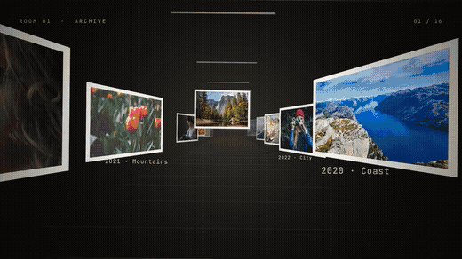
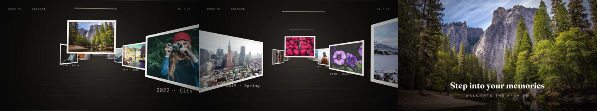

<a href="https://motiongit.com/@prism-studio/visual-art-g-gallery"></a>

# Spatial Gallery · Photo Memories

Travel through a dimensional photo gallery with captions, then move into the main image and a full-screen title.

**16:9 · 1920 × 1080 · 14s · 60 fps** &nbsp; / &nbsp; [@prism-studio](https://motiongit.com/@prism-studio)

[**Get this template on MotionGit ↗**](https://motiongit.com/@prism-studio/visual-art-g-gallery) · [简体中文](README.zh-CN.md)

> Download available · check the current license on MotionGit. Check the live page for availability. Register/sign in and obtain your own .motion when download opens.

## Demo

[](https://motiontemplates.github.io/743702/)

[Watch the original demo](https://media.openaicut.com/previews/621/draft-en-d730d56fb8f4.mp4)



## What to prepare

- **Required:** Photos: text entries, at least 12 items, at most 128 items.
- **Required:** Finale: content group.
- **Required:** Title: text, up to 80 characters.
- **Required:** Titleen: text, up to 80 characters.
- **Required:** Captions: text entries, 6 items.
- **Required:** Bg: text, up to 7 characters.
- **Required:** Wall: text, up to 7 characters.
- **Required:** Light: text, up to 7 characters.

Make the user's photos into the existing visual composition; retain every original effect and time cue..

## Let your assistant guide you

Send the repository URL and this request to Codex, Doubao or another assistant:

```text
https://github.com/motiontemplates/743702
Guide me to make a video with this template. Help me prepare the materials and get my .motion from MotionGit, then check the actual package's dependencies and show a plan and preview before rendering.
```

**For assistants:** read [the production handoff](ASSISTANT.md). Guide the user to the exact MotionGit page above to obtain the real package. While download is pending, help prepare the brief and materials.

## Production setup

- The package declares a Python and Node.js host. Check its dependency lock for supported versions and any additional rendering tools.
- Use the package dependency lock and setup/check instructions. Check existing tools first, install only missing requirements and verify a preview.

First-time setup can take a while. Have the assistant check existing tools, install only missing requirements, verify a short preview, and reuse the environment next time.

## About .motion

MP4 is the finished video. **.motion is the reusable template**: it brings together the animation project, content slots, materials, dependencies and instructions so you can create again with your own content. [Format specification ↗](https://motiongit.com/spec)

MotionGit also supports asset matching, image generation, voiceover and music search where appropriate, subject to the actual template slots, account access and pricing.

---

This repository contains the introduction and public demo. Get the actual template for production on [MotionGit](https://motiongit.com/@prism-studio/visual-art-g-gallery).
